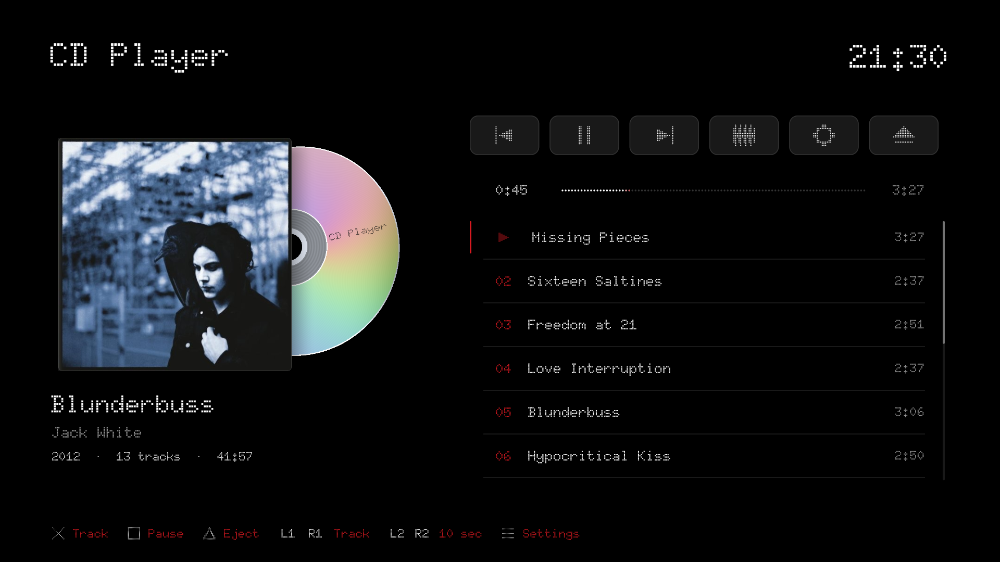
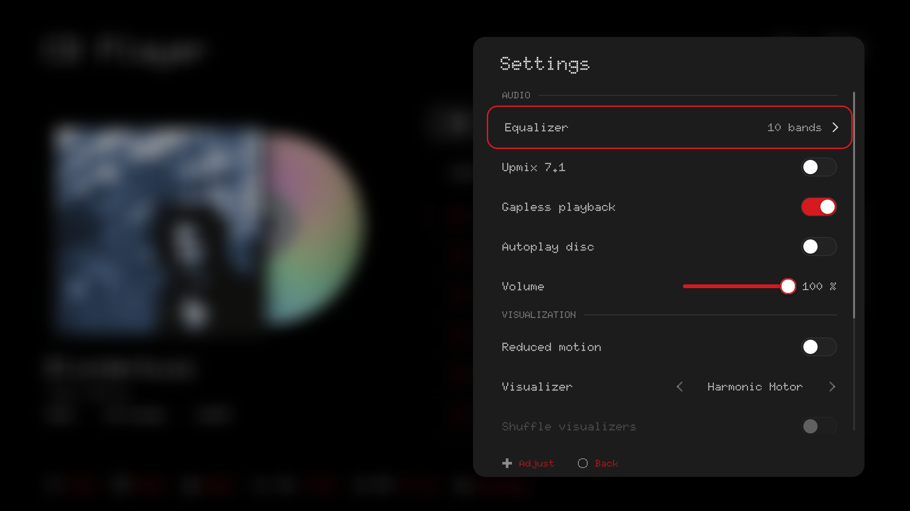
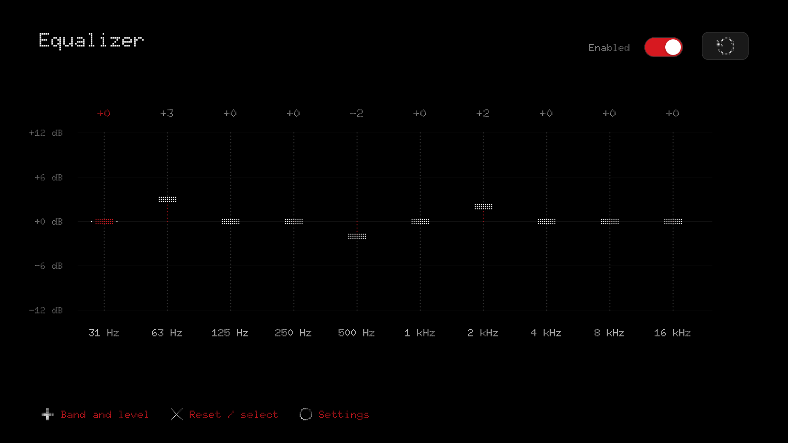
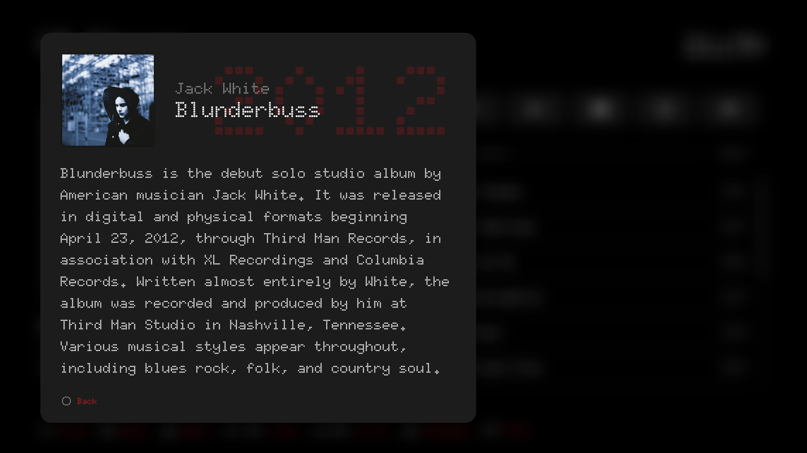
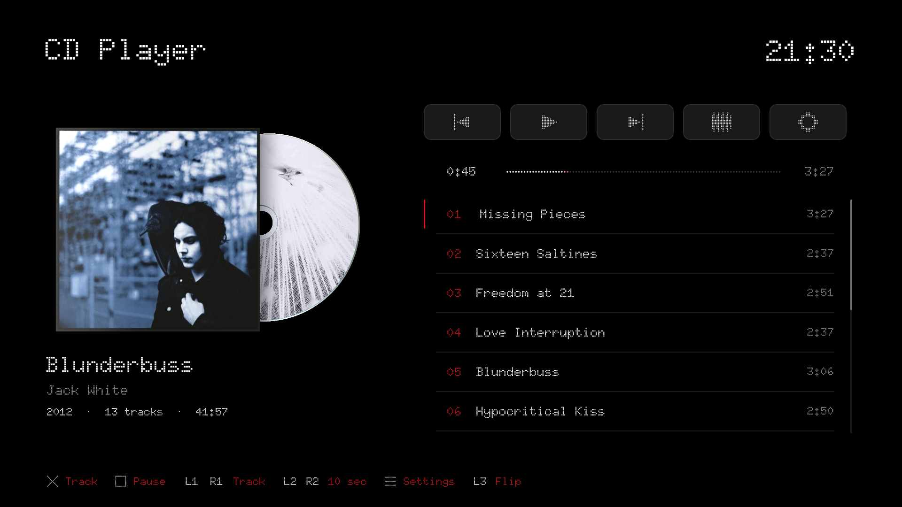
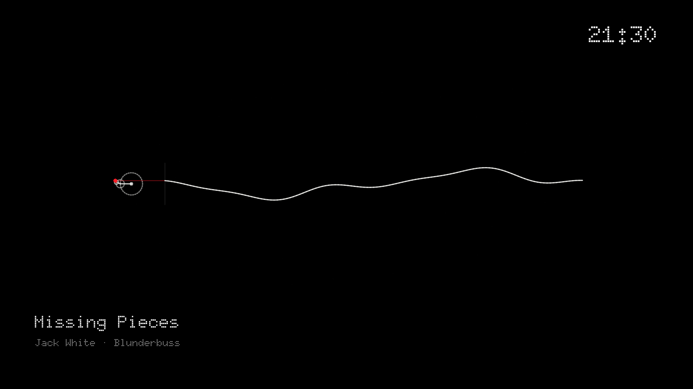

# CD Player

**Rediscover your audio CDs. Fall in love with your music again.**

I wanted to listen to my audio CDs on my PS5. Sony no longer includes that
simple feature on its recent consoles, so I decided to bring it back with
an external USB drive, and with as much attention to the design as to the sound.

CD Player is a native PS5 homebrew app built around the album: a large cover,
a reflective spinning disc, a clear track list and a minimal digital interface.
Put a CD in, settle into your favourite chair, and listen.

Designed by **Andrea Sgarro**.

[Download the latest release](https://github.com/LoZazaMastro/CD-Player/releases/latest)
| [Installation](#installation) | [Controls](#controls) | [Build from source](docs/BUILDING.md)

## A player made for listening

- Play audio CDs from a compatible external USB optical drive, including Apple USB SuperDrive.
- Keep listening when the controller turns off or disconnects.
- Find album artwork, artist, year, track titles and editions through MusicBrainz and Cover Art Archive. CD-Text is used when available.
- Open the album cover to read a description, when one is available. Notes come from MusicBrainz or its linked English Wikipedia article.
- Enjoy a reflective 3D disc that enters with the album, accelerates into playback and slows down gently when paused.
- When available for your edition, the printed CD label fades onto the spinning disc. Press **L3** to turn the 3D case over and see its back and spine. Missing artwork stays blank.
- Choose from **161 individual audio-reactive visualizers**, one at a time, or let the app shuffle them when the track changes.
- Use **OLED mode** to hide fullscreen labels, gently move the effect, and switch to a black screen after a minute of inactivity while playback is stopped.
- Adjust a ten-band equalizer, volume, gapless playback and optional stereo-to-7.1 upmix while listening.
- Balance all eight speakers independently in Speaker setup, including the front pair, center, surround, side and subwoofer channels.
- Read lyrics in Doto with R3 from the fullscreen visualizer. Timed phrases follow the music when available through LRCLIB.
- **Circle** returns straight from lyrics to the album page. Reopening fullscreen restores your last lyrics or visualizer choice.
- Enable **Autoplay disc** if you want a newly inserted CD to start on its own.
- Hide the Eject button if you prefer: the remaining buttons fill the same space, while their icons keep the same size.
- The track list brings the playing track into view when it changes. You can then browse freely without the list pulling you back.
- Keep your settings and chosen visualizer between launches. All interface text is in English.
- Choose an accent from 40 named colors. The interface and visualizers change immediately and remember your choice.

## A quiet interface

Settings open from the right over a softly blurred album view. The equalizer
has its own page. In fullscreen, the effect name and control hints disappear
after two seconds without input, leaving the music, the picture and the clock.

| Listening settings | Ten-band equalizer |
| --- | --- |
|  |  |

| Album notes | Five-button layout |
| --- | --- |
|  |  |

The screenshots are rendered by the app's own preview build, using the same
interface and shaders as the PS5 version, with **Blunderbuss by Jack White**.
Album artwork belongs to its rightsholders; it is downloaded when needed and
is not included as an asset in the application package.

## Installation

You need a PS5 with a compatible, active homebrew environment and an external
USB optical drive capable of reading audio CDs. CD Player does not use the
console's internal disc drive.

1. Download **PPSA98427.zip** from [Releases](https://github.com/LoZazaMastro/CD-Player/releases).
2. Extract the **PPSA98427** folder into a location scanned by your homebrew loader, such as `/data/homebrew/`.
3. Check that the executable is directly at `/data/homebrew/PPSA98427/eboot.bin`, rather than inside another nested folder.
4. Open **CD Player** from the PS5's **Media** section and insert an audio CD.

Close CD Player before replacing its files. The ZIP records the open file
permissions required by the homebrew loader. If your FTP client changes them,
set the app folder and its contents to `0777`.

The included one-shot access helper is restricted to this app's title ID.
Your homebrew environment may need a local ELF loader on port **9021**.
Start the console with the USB drive empty, then insert the CD after boot;
PSSwanStation documents drive lockups when a disc is already present at boot.

### Apple SuperDrive and other USB drives

Apple USB SuperDrive has no physical eject button. The app's **Eject** control
is especially useful for it: select the icon or press **Triangle** to remove
the disc. Apple-specific initialization is included; no Apple Boot Camp drivers
are bundled. Other compatible USB drives can use the same eject command.

USB access follows the CAM/SCSI approach adapted from PSSwanStation. That does
not establish compatibility with every drive model: audio-CD reading still
depends on the USB bridge, drive firmware and console environment.

## Controls

| Button | Action |
| --- | --- |
| D-pad | Navigate; scroll album notes; change fullscreen visualizer with Left/Right |
| Cross | Select a track or control; open the cover when album notes are available |
| Square | Play / pause |
| Triangle | Eject the disc |
| L1 / R1 | Previous / next track |
| L2 / R2 | Seek backward / forward by 10 seconds |
| Touchpad click | Enter / leave the fullscreen visualizer |
| R3, in fullscreen | Switch between the visualizer and lyrics |
| L3, on the album page | Turn the case over; press again to return to the front |
| Right stick up / down | Raise / lower the master volume from any screen |
| Options | Open settings |
| Circle | Back |
| Hold Options, then press Circle | Close the app |

A Play icon in the accent color marks the track you are hearing. When paused, its track number
returns. Hiding the Eject icon also hides its control hint; the Triangle shortcut remains available.

## Sound and saved settings

Audio CDs contain stereo PCM at 44.1 kHz. CD Player resamples it to 48 kHz for
the PS5 audio output. The optional 7.1 upmix derives surround channels from
stereo; it is not an original multichannel recording. The control is unavailable
when the output accepts only stereo.

Speaker setup opens inside the settings drawer and provides eight independent
sliders: front left/right, center, surround left/right, side left/right and LFE
(subwoofer). Each runs from mute to +24 dB. At 0 dB the channel keeps its original
level; the front pair stays unchanged unless you adjust its own sliders.
Changes fade in smoothly, with peak protection on the generated channels and
deliberately boosted front channels. Previously saved upmix gains carry over
to their corresponding speakers, including mute. Front controls also work with
stereo output; generated speakers require 7.1 output and upmix enabled.

Press R3 in the fullscreen visualizer to open lyrics. When LRCLIB has timed
lyrics for the track, the current phrase is highlighted and scrolls smoothly
to the center, following the CD's playback position through pauses and seeks.
If only untimed text is available, it can be scrolled with the D-pad. Some
tracks have no lyrics available. Lyrics need an Internet connection on first
lookup and are cached for later use.
Temporary server errors are retried automatically while the loading message
remains on screen; leaving lyrics or changing tracks cancels further retries.
Returning to lyrics already loaded for the current track opens them directly.

Equalizer settings, upmix, all eight speaker gains, volume, gapless playback, autoplay, reduced motion,
visualizer selection, shuffle, Eject-button visibility and accent color are saved automatically.
They are checked for saving once per second and restored on the next launch.
Updating the app leaves this data outside the installation folder:

- Settings, metadata, artwork cache and session log: `/data/cdplayer-PPSA98427`
- Sandbox fallback: `/download0/cdplayer`

Online album information and covers need an Internet connection on first lookup.
Cached information remains available afterwards. HTTPS certificates and hostnames
are verified against the console's trust store.

## Tested configuration

CD playback, artwork and album descriptions have been confirmed with an Apple
USB SuperDrive on the owner's PS5 running **firmware 13.60**. The tested Media
configuration runs at approximately **60 Hz**. A renderer request for a higher
refresh rate is not a claim of 120 fps support in this release.

Other drive models, firmware versions and surround output configurations need
their own hardware checks. [Build and validation notes](docs/BUILDING.md) explain
the host tests and the distinction between a compiled build and a console test.

## Credits

**Based on PSSwanStation by Press5elect.** Its USB optical-drive work made this possible.

- [PSSwanStation](https://github.com/Press5elect/PSSwanStation) ? Press5elect; optical-drive access and preserved additional attribution terms.
- [Prospero Homebrew UI](https://github.com/blackbearreloaded/ps5-homebrew-ui) and [PS5 Native App Boilerplate](https://github.com/blackbearreloaded/ps5-native-app-boilerplate) ? BlackBearReloaded; interface, native runtime and build foundation.
- [ps5-opengl](https://github.com/blackbearreloaded/ps5-opengl), Mesa and OpenGNM PSBC ? native graphics infrastructure.
- [iwrzwr Visual Archive](https://github.com/kaganin/iwrzwr-visual-archive) ? Kagan Yaldizkaya; the original drawing programs adapted into the visualizer catalog.
- [Doto](https://github.com/oliverlalan/Doto) ? Oliver Lalan and the Doto Project Authors; [Inter](https://github.com/rsms/inter) ? Rasmus Andersson and the Inter Project Authors; typography and fallback glyphs.
- Alfredo Sandoval ? the documented Apple SuperDrive initialization protocol.
- [PS5 Payload SDK](https://github.com/ps5-payload-dev/sdk) ? John T?rnblom and contributors; public homebrew toolchain.
- [PS5-Lapy-JB-Daemon](https://github.com/blackbearreloaded/PS5-Lapy-JB-Daemon) ? Arksama (Team PHU) and upstream contributors; the pinned exact-title access helper.
- [QuickJS](https://bellard.org/quickjs/) ? Fabrice Bellard and Charlie Gordon; local execution of drawing programs.
- MusicBrainz, Cover Art Archive, Wikidata and Wikipedia contributors ? album information and artwork services. Wikipedia text remains under CC BY-SA, with its source URL stored in cached metadata.
- [LRCLIB](https://lrclib.net/) and its contributors supply lyrics and timing data. Lyrics remain the property of their respective rights holders; no song lyrics are bundled with the app.
- libcurl, OpenSSL, libpsl, zstd, zlib, nlohmann/json and stb ? networking, decoding and supporting libraries.

Full component notices and license texts are in [THIRD_PARTY_NOTICES.md](THIRD_PARTY_NOTICES.md)
and [licenses/](licenses/).

## License

CD Player is released under **GPL-3.0-or-later**, with PSSwanStation's preserved
additional attribution terms. Third-party components retain their own licenses.
See [LICENSE](LICENSE) and [the additional terms](licenses/PSSwanStation-ADDITIONAL-TERMS.txt).

This is an independent homebrew project, not affiliated with Sony or Apple.
No Sony SDK binaries, Boot Camp drivers, firmware, keys or CD recordings are
included in this repository or release.
